# Signal Finder & Analyzer for the M5Stack Tab5

A "hot / cold" finder for Bluetooth and Wi-Fi devices, for the M5Stack Tab5
(ESP32-P4 with an ESP32-C6 radio chip). Pick a device from the list, then walk
toward it: the signal number, meter, beeps and colour all get stronger as you
get closer. Made for finding things like a dropped earbud, a tracker tag, or a
hidden access point.

| | | |
| --- | --- | --- |
| 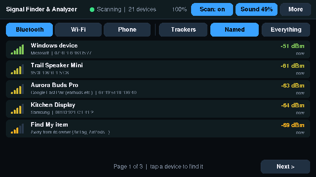 | 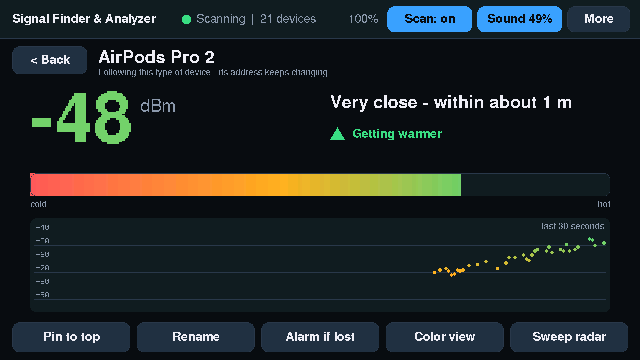 | 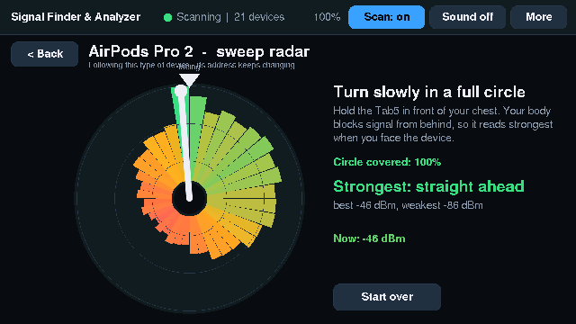 |
| Device list | Hot / cold finder | Sweep radar |
| 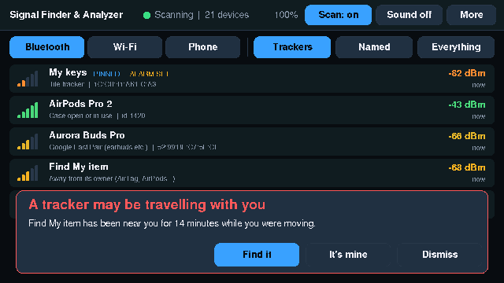 | 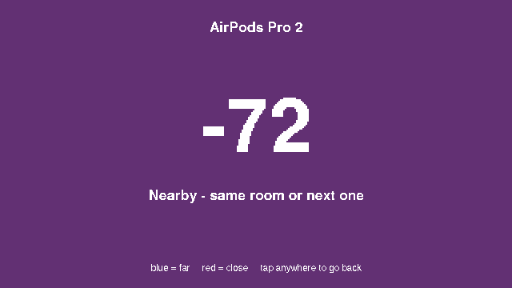 | 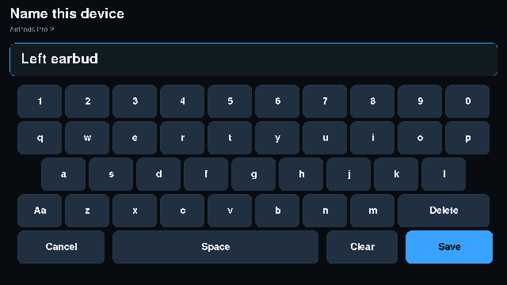 |
| Tracker alert, with a pinned and renamed device | Colour view | Rename keyboard |
| 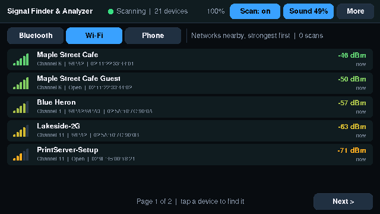 | 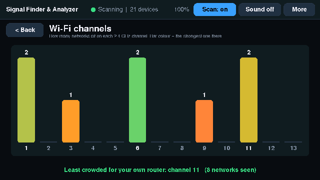 | 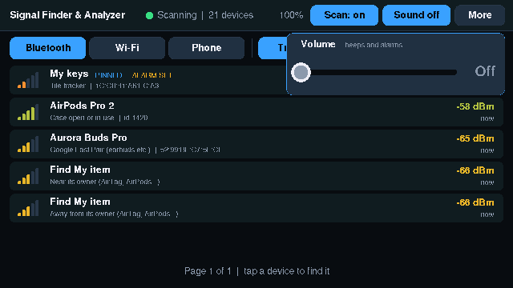 |
| Wi-Fi networks | Wi-Fi channel chart | Volume slider |
| 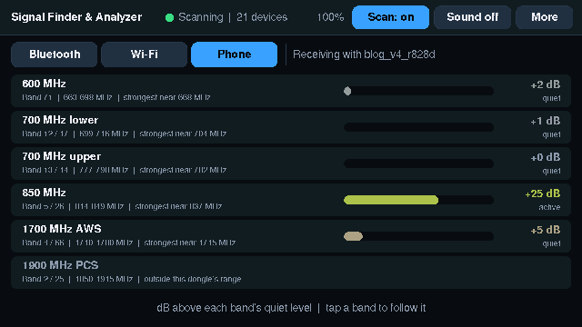 | 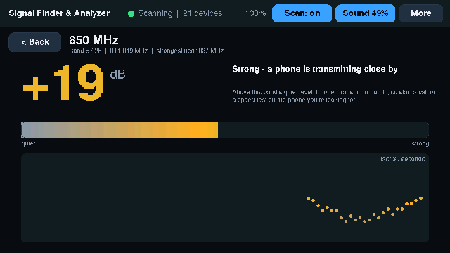 | 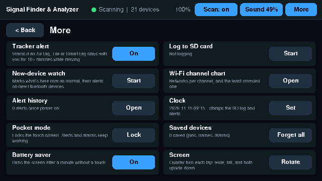 |
| Phone bands | Following one phone band | More screen |

Portrait works too:

| | | |
| --- | --- | --- |
| 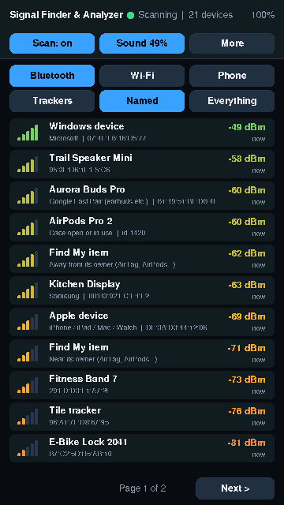 | 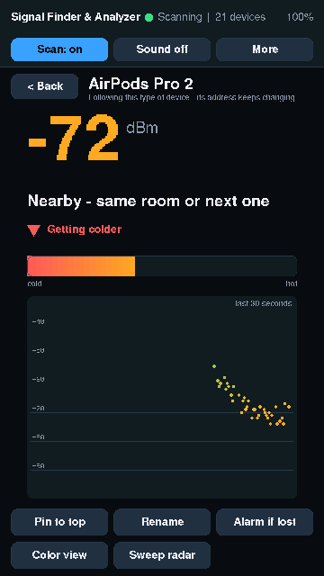 | 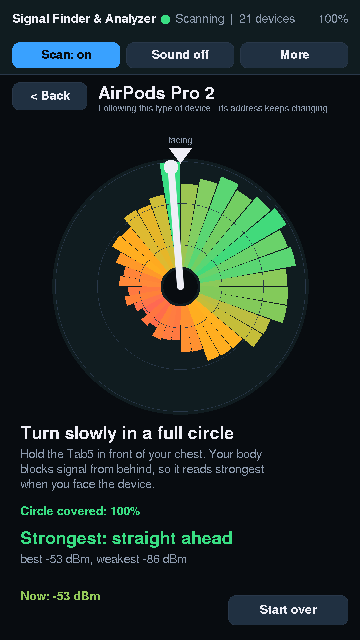 |

All screenshots were taken in demo mode, so every device name, network name,
address and reading in them is made up.

## What it does

**Finding**

- **Device list** - Bluetooth LE devices nearby, strongest first. Recognises
  AirPods and Beats (with model), Find My items (AirTags etc.), Tile, Galaxy
  SmartTag, Google Fast Pair earbuds, and Apple, Samsung and Windows devices.
- **Wi-Fi section** - 2.4 GHz networks, found the same way. While you track
  one, the scanner stays on its channel for faster updates.
- **Hot / cold screen** - big signal reading, warmer / colder trend, meter,
  30-second graph, and Geiger-style beeps that speed up as you close in.
- **Sweep radar** - turn in a circle holding the Tab5; the motion sensor maps
  signal strength to direction and points at the strongest.
- **Colour view** - the whole screen goes from blue (far) to red (close), with
  no sound, for quiet places.

**Phone bands (optional, needs an RTL-SDR dongle)**

- **Phone section** - with an RTL-SDR plugged into the Tab5's USB-A port, shows
  how strongly phones are transmitting on each US mobile band (600, 700, 850
  and 1700 MHz; 1900 MHz is outside an RTL-SDR's range).
- **Follow a band** - tap one for the same hot / cold screen, measured as dB
  above that band's quiet level.
- It measures signal strength only. Nothing is demodulated or decoded, so it
  cannot tell whose phone it is or what is being sent. Phones transmit in
  bursts; a call or a speed test on the phone you are looking for makes it
  much easier to find.

**Keeping track**

- **Pin and rename** - pin a device to the top of the list and give it your own
  name.
- **Left-behind alarm** - alarms if a chosen device hasn't been heard for a
  minute.
- **Tracker alert** - warns if an AirTag (separated from its owner), Tile or
  SmartTag stays near you for 10+ minutes while the Tab5 is being carried.
- **New-device watch** - mark the surroundings as normal, then get an alert
  when a new Bluetooth device shows up.
- **Alert history** - past alerts since power-on, newest first.
- **Pocket mode** - locks the touch screen (hold a circle for two seconds to
  unlock) while scanning, alerts and alarms keep running.

**Tools**

- **Wi-Fi channel chart** - networks per channel, and the least crowded of
  channels 1, 6 and 11.
- **Log to SD card** - writes what it hears to `FINDLOG/LOGnnnnn.CSV` every
  10 seconds.
- **Clock** - set the date and time once; the Tab5's clock chip keeps it and it
  stamps the SD log and alerts.
- **Battery saver** - dims the screen and slows redraws after a minute without
  a touch.
- Volume slider, scan on / off, and four screen orientations (landscape and
  portrait, each either way up).
- **Power off** - switches the Tab5 off from the More screen.
- **Error reports** - if the app ever crashes, the next start offers to save a
  report to the SD card (`FINDLOG/ERRnnnnn.TXT`, plus the raw crash dump as
  `CORnnnnn.BIN`). You
  can also save one any time from the More screen. Reports hold app logs, crash
  details and settings, and no names or addresses of nearby devices or
  networks. If you hit a problem, attach one to a GitHub issue.

## Limits worth knowing

- Signal strength is a rough guide, not a distance. Walls, bodies and
  reflections move it around; trust the trend over a few seconds.
- Find My items never broadcast their name - only an anonymous, changing key -
  so they show as "Find My item". Nothing nearby can read the name.
- Phones, AirPods and Find My items near their owner change address every few
  minutes. AirPods are followed by model instead; a nickname on other rotating
  devices only lasts until the address changes.
- The Tab5's radio only hears 2.4 GHz Wi-Fi.
- The tracker alert uses the motion sensor to tell whether you are moving, so
  smooth travel (a car on a motorway) may not count as movement.
- The app only listens. It never connects to, pairs with, or sends anything to
  the devices it lists. The SD log stays on the card.
- The phone-band readings are relative, not calibrated power. Other
  transmitters share some of these frequencies, and a full sweep of all bands
  takes about ten seconds.

## Hardware

- M5Stack Tab5. Built and tested on a unit with ESP32-P4 chip revision v1.3
  and the ST7121 display panel.
- The ESP32-C6 radio chip must run ESP-Hosted **3.0.6 with Bluetooth enabled**.
  Some firmware (for example a Wi-Fi-only build) leaves Bluetooth off. If the
  app finds that, it offers to install a Wi-Fi + Bluetooth build of the same
  version over the internal link. That build is included as
  `main/c6_radio_fw.bin`; it is Espressif's ESP-Hosted co-processor example
  (`bleprph_wifi_coex/cp`, Apache-2.0) built for the Tab5's C6.

## Install

Take `signal_finder.bin` from the releases page (or build it), then either:

- copy it to the SD card and install it with the
  [M5Launcher](https://github.com/bmorcelli/Launcher), or
- flash it as the only app. This overwrites the boot loader, partition table
  and whatever app is installed:

```
python -m esptool --chip esp32p4 write_flash 0x2000 build/bootloader/bootloader.bin 0x8000 build/partition_table/partition-table.bin 0x10000 build/signal_finder.bin
```

The app needs about 2.7 MB, so the Launcher app slot must be at least that big.

Under the Launcher, a power-on shows the Launcher first, as it should. Two
quirks are handled for that:

- Some Tab5 units report a watchdog reset instead of a plain power-on when
  switched on, so the Launcher's boot loader starts the installed app directly.
  When this app sees it was started that way, it makes the Launcher the boot
  target and restarts into it. Choosing the app in the Launcher brings you
  back.
- The Launcher keeps a flag that makes every other start skip its own screen.
  This app clears it.

## Build

Needs ESP-IDF v5.5.x.

```
idf.py set-target esp32p4
idf.py build
```

On Windows, `build.ps1` does the same and sets a short component cache path
(ESP-Hosted's nested file names overflow the 260-character path limit
otherwise).

Dependencies are fetched by the IDF component manager: `esp_hosted` 3.0.6,
`esp_wifi_remote`, `M5Unified` and `M5GFX`.

### Phone bands: the optional RTL-SDR driver

The Phone section uses [esp-rtl-sdr](https://github.com/hardcoreerik/esp-rtl-sdr),
a USB host driver for RTL-SDR dongles on the ESP32-P4. It is licensed
**AGPL-3.0-only** and is deliberately not part of this repository. To build it
in, put it in `components/esp_rtl_sdr` before building:

```
git clone https://github.com/hardcoreerik/esp-rtl-sdr.git components/esp_rtl_sdr
```

Developed against commit `bf99e997` (driver 0.9.6), with an RTL-SDR Blog V4.
The driver also lists the Blog V3 and V4 Lite, Nooelec SMArt v5 and E4000
dongles as supported. Without that folder the app builds and runs normally and
the Phone section says the driver isn't included. If you add or remove the
folder after a first build, run `idf.py reconfigure` so the build notices.

### Demo mode

`idf.py -DFINDER_DEMO=1 build` makes a build that shows made-up devices,
networks and phone-band activity instead of scanning. The screenshots here
were taken with it. Build again with `-DFINDER_DEMO=0` to go back.

## How the screen stays fast

The Tab5's panel is natively portrait and its frame buffer is in external RAM.
Letting the graphics library rotate each landscape frame in software took about
650 ms. Instead, frames are drawn the way you hold the Tab5 into one of two buffers, and a
background task uses the ESP32-P4's PPA hardware to rotate the finished buffer
into the display and clear it for reuse while the next frame is drawn. That
gives about 17 frames a second.

## Source layout

| File | What it holds |
| --- | --- |
| `main/main.cpp` | Start-up |
| `main/ble_scan.cpp` | ESP-Hosted link, Bluetooth scanning, radio-chip update |
| `main/wifi_scan.cpp` | Wi-Fi scanning |
| `main/devices.cpp` | Device table, advertisement parsing, signal history |
| `main/saved.cpp` | Pinned / renamed / alarmed devices, stored in flash |
| `main/alerts.cpp` | Tracker, new-device and left-behind alerts |
| `main/sdlog.cpp` | SD card log |
| `main/clock.cpp` | Date and time |
| `main/sdr.cpp` | Phone-band meter (RTL-SDR) |
| `main/errlog.cpp` | Error log and crash reports |
| `main/demo.cpp` | Demo mode |
| `main/ui.cpp` | All screens |

## License

The code in this repository is released under the [MIT License](LICENSE).

Two things it works with have their own licenses:

- `main/c6_radio_fw.bin` is a build of Espressif's ESP-Hosted co-processor
  firmware (Apache-2.0).
- The optional `esp_rtl_sdr` driver is AGPL-3.0-only. A firmware image built
  with it is a combined work, so if you share such an image you must do so
  under the AGPL's terms, including making the complete source available. The
  release binaries here are built with the driver; their complete source is
  this repository plus the driver at the commit named above.
